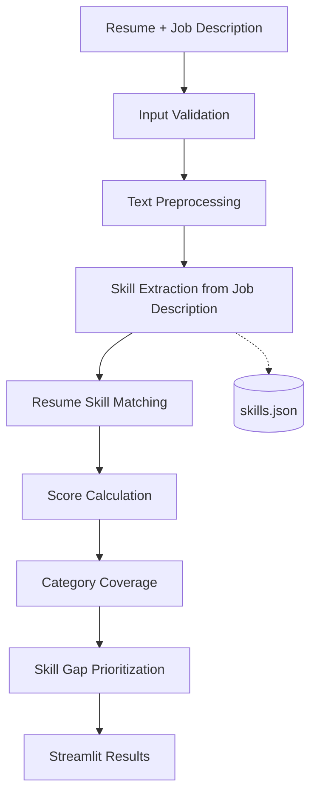
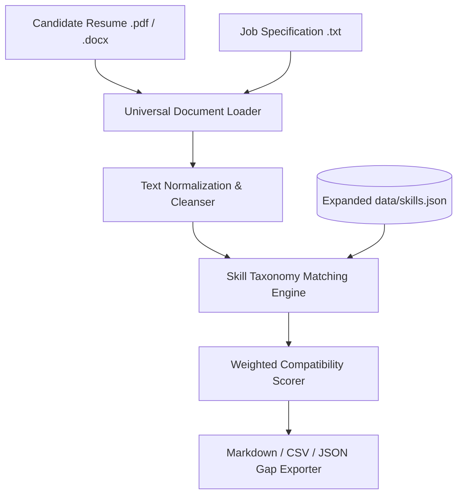

# JobFit - Resume & Skill Gap Analyzer

> Enhanced implementation of **Learn Depth Track 1 — Project #56: Resume Keyword Analyzer**

JobFit is a Python application that compares a resume with a job description and identifies the technical skills that are present or missing. It provides a transparent keyword coverage score, category-wise analysis, and prioritized skill gaps to help users understand how closely their resume matches a particular technical role.

This project was developed as part of the **Learn Depth Machine Learning Internship – Track 1 – Level-4 Python Project Challenge**.

---

## 📌 Problem Statement

Job seekers often find it difficult to determine how well their resume matches the technical requirements of a particular job description.

Manually comparing a resume with a job description can be time-consuming and may cause important technical requirements to be overlooked.

**JobFit** addresses this problem by extracting technical skills from a job description and checking whether those skills are present in the resume. The application then presents the matched skills, missing skills, category coverage, and prioritized skill gaps in an easy-to-understand format.

The project uses a **rule-based and deterministic approach** so that the analysis is transparent and easy to understand.

> **Note:** JobFit provides keyword coverage analysis. It is not an official ATS score, recruitment prediction system, or hiring decision tool.

---

## 🎯 Objective

The main objectives of JobFit are to:

- Compare resume content with a target job description.
- Identify relevant technical skills mentioned in the job description.
- Determine which of those skills are present in the resume.
- Identify missing technical skills.
- Calculate a transparent keyword coverage score.
- Show skill coverage by technical category.
- Prioritize missing skills based on their importance in the job description.
- Provide clear explanations for the assigned skill priorities.
- Demonstrate modular Python development, validation, exception handling, testing, and documentation.

---

## ✨ Features

### 1. Dual Input Modes

Users can provide both the resume and job description through:

- Direct text input
- `.txt` file upload

### 2. Demo Samples

The application provides sample inputs that can be used to quickly demonstrate different matching scenarios.

### 3. Text Preprocessing

The input text is normalized before analysis by:

- Converting text to a consistent case
- Cleaning unnecessary whitespace
- Preserving important technical characters

Technical terms such as:

- `C++`
- `C#`
- `Node.js`
- `REST API`
- `CI/CD`

require special handling during preprocessing and matching.

### 4. Boundary-Aware Skill Matching

The application avoids simple substring matching to reduce false positives.

For example:

- `Java` should not match `JavaScript`
- `C` should not match `C++`

This is handled using regular-expression-based matching rules.

### 5. Transparent Keyword Match Score

The application calculates a keyword coverage score based on the skills detected in the job description.

```text
Keyword Match Score (%) =
(Matched JD Skills / Total Extracted JD Skills) × 100
```

The score represents **keyword coverage only** and should not be interpreted as an ATS score or probability of getting selected.

### 6. Category-Wise Coverage

Detected skills are organized into categories such as:

- Programming Languages
- Frameworks & Libraries
- Databases
- Core CS Concepts
- Tools & Cloud

This helps users understand which technical areas are well represented in their resume.

### 7. Explainable Skill Gap Prioritization

Missing skills are classified into three priority levels:

- 🔴 **High Priority** — Skill appears at least twice in the job description.
- 🟡 **Medium Priority** — Core technical skill appears once.
- 🔵 **Low Priority** — Supporting tool or auxiliary skill appears once.

The application also provides a reason for each priority so that the result is understandable rather than just displaying an unexplained ranking.

### 8. Input Validation and Exception Handling

The application handles situations such as:

- Empty resume input
- Empty job description
- Whitespace-only input
- Invalid or unreadable files
- Unsupported file types
- Job descriptions containing no recognized skills

The goal is to provide a clear message instead of allowing the application to crash.

---

## 🛠️ Technologies Used

- **Python 3.x** — Core programming language
- **Streamlit** — Interactive web interface
- **Pytest** — Automated testing
- **Python Standard Library**
  - `re`
  - `json`
  - `os`
  - `dataclasses`
  - `typing`

No paid APIs, external AI services, or paid software are required.

---

## 🏗️ Project Architecture

JobFit follows a modular pipeline architecture.



### Processing Flow

1. **Input Validation**  
   Checks whether the provided resume and job description are valid.

2. **Text Preprocessing**  
   Normalizes the input while preserving important technical characters.

3. **Skill Extraction**  
   Checks the job description against the predefined technical skill taxonomy.

4. **Resume Matching**  
   Checks whether the extracted job-description skills are present in the resume.

5. **Score Calculation**  
   Calculates the overall keyword coverage percentage.

6. **Category Coverage**  
   Groups skills by technical category and calculates coverage.

7. **Skill Gap Prioritization**  
   Assigns priorities to missing skills based on their occurrence and category.

8. **Results Presentation**  
   Displays the results through the Streamlit interface.

---

## 📁 Project Structure

```text
JobFit/
│
├── app.py
├── requirements.txt
├── README.md
├── PROJECT_REPORT.pdf
├── TEST_CASES.md
├── .gitignore
│
├── src/
│   ├── __init__.py
│   ├── models.py
│   ├── validator.py
│   ├── file_handler.py
│   ├── preprocessing.py
│   ├── extractor.py
│   ├── matcher.py
│   ├── scoring.py
│   ├── skill_gap.py
│   └── analyzer.py
│
├── data/
│   └── skills.json
│
├── tests/
│   └── test_jobfit.py
│
└── screenshots/
    ├── 01_main_input_screen.png
    ├── 02_inputs_entered.png
    ├── 03_analysis_overview.png
    └── 04_category_and_skill_gaps.png
```

### Main Components

| File | Responsibility |
|---|---|
| `app.py` | Streamlit application and user interface |
| `src/analyzer.py` | Coordinates the complete analysis pipeline |
| `src/models.py` | Defines application data structures using dataclasses |
| `src/validator.py` | Validates text and uploaded files |
| `src/file_handler.py` | Handles `.txt` file reading |
| `src/preprocessing.py` | Performs text normalization |
| `src/extractor.py` | Loads the skill taxonomy and extracts skills |
| `src/matcher.py` | Performs boundary-aware skill matching |
| `src/scoring.py` | Calculates scores and category coverage |
| `src/skill_gap.py` | Prioritizes missing skills |
| `data/skills.json` | Contains the technical skill taxonomy |
| `tests/test_jobfit.py` | Automated pytest test suite |

---

## ⚙️ Installation & Setup

### 1. Clone the repository

```bash
git clone https://github.com/Chethan13032005/JobFit.git
cd JobFit
```

### 2. Create a virtual environment

Creating a virtual environment is recommended but optional.

**Windows:**

```bash
python -m venv venv
venv\Scripts\activate
```

**macOS / Linux:**

```bash
python3 -m venv venv
source venv/bin/activate
```

### 3. Install dependencies

```bash
pip install -r requirements.txt
```

---

## 🚀 How to Run

Start the Streamlit application:

```bash
streamlit run app.py
```

After starting the application, Streamlit will provide a local URL.

The application is normally available at:

```text
http://localhost:8501
```

---

## 🧪 How to Run Tests

Run the automated test suite using:

```bash
python -m pytest tests/ -v
```

The test suite contains **14 automated test cases** covering normal scenarios and important edge cases.

---

## 🔍 How the Matching Algorithm Works

### Step 1 — Extract Skills from the Job Description

The application uses the predefined taxonomy in:

```text
data/skills.json
```

The job description is scanned for recognized technical skills.

### Step 2 — Match Skills Against the Resume

Each extracted job-description skill is checked against the resume using boundary-aware matching.

This helps avoid cases such as:

```text
Java → JavaScript
C → C++
```

being incorrectly treated as matches.

### Step 3 — Calculate Coverage

The score is calculated as:

```text
Keyword Match Score (%) =
(Matched JD Skills / Total Extracted JD Skills) × 100
```

### Step 4 — Identify Skill Gaps

Skills found in the job description but not in the resume are reported as missing skills.

### Step 5 — Prioritize Missing Skills

The missing skills are classified using simple, explainable rules:

```text
High Priority
    ↓
Mentioned 2 or more times in the JD

Medium Priority
    ↓
Core technical skill mentioned once

Low Priority
    ↓
Supporting/tool skill mentioned once
```

---

## 🧪 Testing Results

The project contains **14 automated pytest tests**.

The tests cover:

| Test Area | What is Verified |
|---|---|
| Strong Match | Correct analysis when most skills are present |
| Partial Match | Correct separation of matched and missing skills |
| Zero Match | Correct handling when no skills match |
| Empty Input | Validation of empty and whitespace-only input |
| File Validation | Handling of missing or unreadable files |
| Case Variations | Consistent matching regardless of case |
| Phrase Variations | Correct handling of multi-word technical skills |
| Java vs JavaScript | Prevention of substring collision |
| C vs C++ | Prevention of incorrect skill matching |
| Skill Prioritization | Correct High/Medium/Low classification |
| Alias Deduplication | Prevents duplicate counting of aliases |
| Special Characters | Handling of skills such as `C#`, `Node.js`, and `CI/CD` |
| Unrecognized Skills | Handles JDs with no recognized taxonomy skills |
| Category Coverage | Correct calculation of category-level percentages |

**Final test result: 14 automated tests passed successfully.**

---

## 📸 Demonstration Screenshots

The project includes four screenshots demonstrating the main application workflow.

| Screenshot | Description |
|---|---|
| `01_main_input_screen.png` | JobFit landing screen showing the application purpose and input fields. |
| `02_inputs_entered.png` | Resume and job description populated with sample data before analysis. |
| `03_analysis_overview.png` | Overall keyword coverage score with matched and missing skills. |
| `04_category_and_skill_gaps.png` | Category-wise coverage and prioritized skill gaps with explanations. |

---

## 📄 Project Report

The complete technical project report is provided separately in:

```text
PROJECT_REPORT.pdf
```

The report covers:

- Problem understanding
- Requirement analysis
- Proposed approach
- System design
- Implementation
- Technical decisions
- Algorithms
- Challenges encountered
- Solutions implemented
- Testing
- Future scope
- Conclusion

---

## ⚠️ Limitations

The current implementation has a few limitations:

1. **Predefined Skill Taxonomy**  
   The application identifies skills that are included in `data/skills.json`. New or uncommon skills may not be detected until they are added to the taxonomy.

2. **Keyword-Based Analysis**  
   The application checks explicit keyword presence rather than understanding the deeper semantic meaning of the resume.

3. **Text File Support**  
   The current version supports direct text input and `.txt` files. PDF and DOCX parsing are not currently implemented.

4. **No ATS Prediction**  
   The keyword match score is only a coverage measurement. It does not attempt to predict an actual ATS decision or hiring outcome.

---

## 🔮 Future Improvements

The following features could be considered for future versions:

### PDF and DOCX Support

Add document parsing so users can upload resumes directly in commonly used formats such as PDF and DOCX.

### Improved Skill Recognition

Use semantic techniques to recognize related terms and synonyms rather than relying only on explicit keyword matches.

### Custom Skill Taxonomy

Allow users to add or edit skills according to their target job role or industry.

### Report Export

Allow users to export their analysis results as PDF, Markdown, or CSV for later reference.

### Detailed Resume Analysis

Extend the application to analyse different resume sections such as:

- Projects
- Experience
- Education
- Certifications
- Technical Skills

---

## 🎓 What I Learned

Through this project, I learned how to develop a Python application from a real-world requirement and take it through the complete development process.

The main concepts I worked with include:

- Python functions and modular programming
- Lists and dictionaries
- JSON handling
- File handling
- Input validation
- Exception handling
- Regular expressions
- Text preprocessing
- Keyword extraction
- Object-oriented programming
- Dataclasses
- Automated testing with pytest
- Streamlit application development
- Git and GitHub project management

I also learned how important it is to test edge cases when working with text matching, particularly when technical terms have similar names such as `Java` and `JavaScript`.

---

## 👤 Project Information

**Project:** JobFit — Resume & Skill Gap Analyzer  
**Challenge:** Learn Depth Track 1 — Project #56: Resume Keyword Analyzer  
**Language:** Python  
**Interface:** Streamlit  
**Testing:** Pytest  
**Cost:** Zero-cost / Free resources

---

## 📌 Note

This project is intended as an internship learning project demonstrating Python programming, problem-solving, software development, testing, documentation, and technical understanding.

The skill-gap prioritization is an enhancement to the selected **Project #56 — Resume Keyword Analyzer** and does not represent a separate project selection.


## JobFit Architecture Flow



### Domain-Weighted Compatibility Scoring
Unlike naive keyword counting, JobFit applies domain weighting:
- **Core Languages**: 25%
- **Frameworks & Libraries**: 20%
- **Cloud Infrastructure (AWS/GCP)**: 15%
- **Containerization & Kubernetes**: 30%
- **Modern AI / Vector Search**: 10%


## CLI Usage Guide

```bash
# Run analysis on a candidate PDF against a Target Job Spec
python -m src.cli --resume candidate_resume.pdf --job job_spec.txt --format markdown

# Export executive HTML report
python -m src.cli --resume candidate_resume.docx --job job_spec.txt --format html
```
