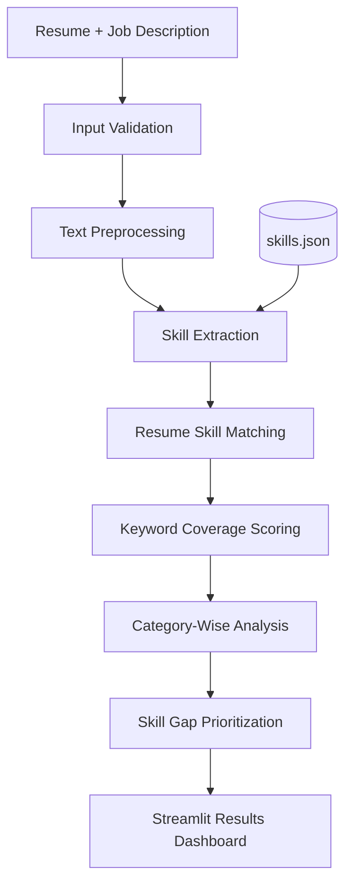
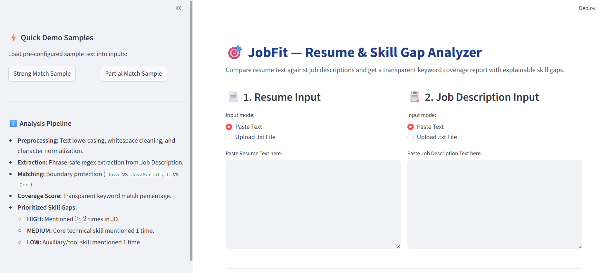
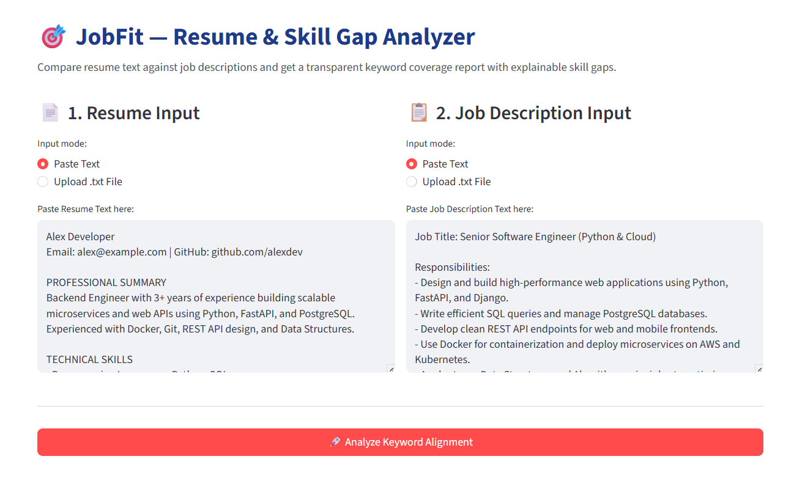
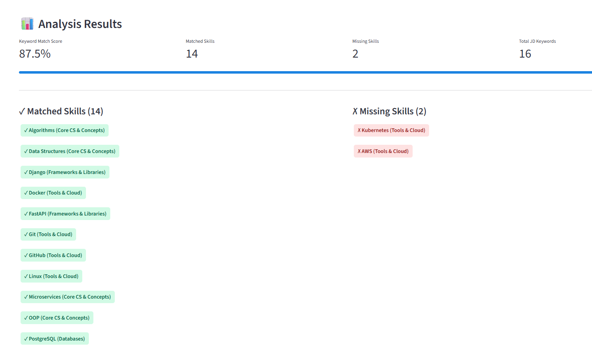
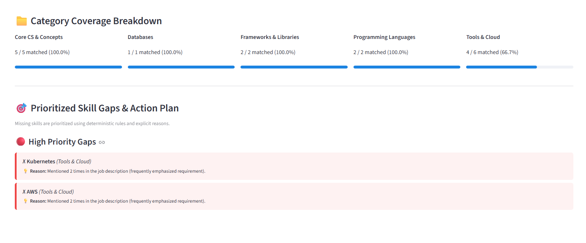

# JobFit – Resume & Skill Gap Analyzer

A Python-based application that compares a resume against a job description to identify matched skills, missing skills, and technical skill gaps using deterministic keyword matching.

## ✨ Key Features

- **Resume Analysis:** Accepts resume and job description through text input or `.txt` uploads.
- **Skill Extraction:** Identifies technical skills using a predefined skill taxonomy.
- **Boundary-Aware Matching:** Prevents incorrect matches such as `Java` with `JavaScript`.
- **Keyword Coverage Score:** Calculates a transparent percentage of matched job-description skills.
- **Category-Wise Analysis:** Groups skills into programming languages, frameworks, databases, core CS, and tools.
- **Skill Gap Prioritization:** Classifies missing skills into High, Medium, and Low priority.

## 🛠️ Tech Stack

| Category | Technologies |
|---|---|
| Language | Python 3 |
| Frontend | Streamlit |
| Matching | Regular Expressions |
| Data Configuration | JSON |
| Testing | Pytest |

## 🏗️ System Architecture



## 📁 Project Structure

```text
JobFit/
│
├── app.py
├── requirements.txt
│
├── src/
│   ├── models.py
│   ├── validator.py
│   ├── file_handler.py
│   ├── preprocessing.py
│   ├── extractor.py
│   ├── matcher.py
│   ├── scoring.py
│   ├── skill_gap.py
│   └── analyzer.py
│
├── data/
│   └── skills.json
│
├── tests/
│   └── test_jobfit.py
│
├── screenshots/
│   ├── 01_main_input_screen.png
│   ├── 02_inputs_entered.png
│   ├── 03_analysis_overview.png
│   └── 04_category_and_skill_gaps.png
│
├── PROJECT_REPORT.pdf
├── TEST_CASES.md
└── README.md
```
## 📸 Application Screenshots

<table>
  <tr>
    <td align="center" width="50%">
      <strong>1. Main Input Interface</strong><br><br>
      
    </td>
    <td align="center" width="50%">
      <strong>2. Resume & Job Description Input</strong><br><br>
      
    </td>
  </tr>
  <tr>
    <td align="center" width="50%">
      <strong>3. Analysis Overview</strong><br><br>
      
    </td>
    <td align="center" width="50%">
      <strong>4. Category Coverage & Skill Gaps</strong><br><br>
      
    </td>
  </tr>
</table>

---
## ⚙️ Installation & Setup

### 1. Clone the repository

```bash
git clone https://github.com/Chethan13032005/JobFit.git
cd JobFit
```

### 2. Create a virtual environment

```bash
python -m venv venv
```

Activate it on Windows:

```bash
venv\Scripts\activate
```

### 3. Install dependencies

```bash
pip install -r requirements.txt
```

### 4. Run the application

```bash
streamlit run app.py
```

Open `http://localhost:8501` in your browser.

## 🧪 Run Tests

```bash
python -m pytest tests/ -v
```

The repository documents 14 automated test cases covering matching, validation, special characters, skill prioritization, and category coverage.

## 📊 Scoring Logic

```text
Keyword Match Score (%) =
(Matched JD Skills / Total Extracted JD Skills) × 100
```

Missing skills are prioritized based on their frequency and technical category.

**Note:** This is a keyword coverage score, not an official ATS score or hiring prediction.

## 📄 Documentation

- [View Project Report](./PROJECT_REPORT.pdf)
- [View Test Cases](./TEST_CASES.md)

## 👨‍💻 Author

**Chethan A.**

[GitHub Profile](https://github.com/Chethan13032005)

[Project Repository](https://github.com/Chethan13032005/JobFit)
